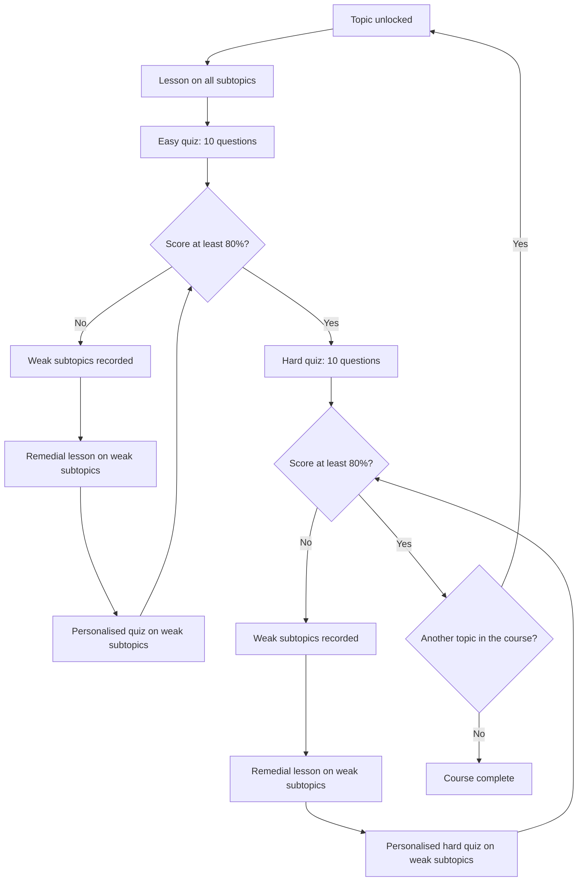

# AdaptiveTutor backend

AdaptiveTutor is an adaptive tutoring app for undergraduate computer science courses, built as my final-year BSc project (Department of Computer Science, Adeleke University, 2026). This repository is its backend: a FastAPI service that stores learner progress in Cloud Firestore and uses an OpenAI language model to write lessons, personalised quizzes, hints and grading for short typed answers. Students move through a course one topic at a time, and a topic is unlocked only after the student scores at least 80% on both an easy and a hard quiz for the topic before it. The mobile and web client is in a [separate repository](https://github.com/chukaik/adaptive-tutor-frontend).

Two courses are currently loaded by the seed scripts: COS201 Computer Programming I (8 topics, taught in Java) and CSC301 Data Structures (6 topics, taught in C++).

## The problem it addresses

In a typical course every student receives the same material at the same pace, and a student can move on to a new topic with gaps in an earlier one. AdaptiveTutor tries to address this in two ways: it gates progression on a mastery threshold, and after a failed quiz it gives the student a lesson and a quiz aimed at the subtopics they got wrong rather than repeating the same material.

> TODO (author): add the motivating sources or observations from the project report, if you want to cite them here.

## How it works

1. **Starting a course.** After sign-up the client calls `/onboarding/complete` (or `/adaptive/init-course`). This creates one `student_progress` record per topic; only the first topic is unlocked.
2. **Lesson.** `/lesson/fetch` asks the model for a lesson covering every subtopic of the topic. The prompt includes the topic's curriculum guide (lecturer's notes and CCMAS curriculum notes stored in Firestore), so the lesson is grounded in the course content. The lesson is saved per student and served from storage on later visits.
3. **Easy quiz.** `/quiz/fetch` picks 10 questions at random from the topic's question bank for the requested difficulty (the seed scripts write 15 per difficulty per topic). Correct answers are never sent to the client.
4. **Grading.** `/quiz/submit` grades each answer. Multiple-choice answers are compared with the stored answer (case-insensitive, ignoring surrounding whitespace). Typed answers are graded by the model, which is asked to judge meaning rather than exact wording and returns a verdict and a one-sentence reason. The score is the percentage of answers marked correct.
5. **The 80% rule** (`services/adaptive_engine.py`):

   | Quiz | Score | Result | Mastery recorded |
   |---|---|---|---|
   | Easy | 80% or more | Hard quiz unlocked | medium |
   | Hard | 80% or more | Next topic unlocked (or course complete if it was the last topic) | high |
   | Either | 60% to under 80% | Stay on the topic | medium |
   | Either | under 60% | Stay on the topic | low |

6. **After a failed quiz.** The response lists every question with the student's answer, the correct answer, an explanation and the question's subtopic. The subtopics of the wrong answers are saved as the topic's `weak_areas`. The client can then request:
   - a **remedial lesson** (`/lesson/remedial`) covering only the weak subtopics, written with simpler language, more analogies and more worked examples;
   - a **personalised quiz** (`/quiz/generate-personalized`) of 10 new model-written questions focused on the weak subtopics, at the difficulty the client requests.

   The student retakes the quiz at the same difficulty. The backend sets no limit on attempts.



The assistant **Chukky** (`/chat/message`) answers questions about the course and about how the app works. Its system prompt describes the app and both courses; the client may pass the topic the student is studying, and the last 10 messages of the conversation are included for context.

> TODO (author): confirm in the frontend that it calls the remedial lesson and personalised quiz automatically after a failed quiz (the backend only provides the endpoints).

## Architecture

```
main.py                  FastAPI app: routers, CORS, auth dependency, 502 handler
routes/                  One module per area of the API
  onboarding.py          Profile and initial topic progress
  adaptive.py            Initialise progress for one course
  lesson.py              Initial and remedial lessons, lesson history
  quiz.py                Fetch, submit and grade quizzes; hints; personalised quizzes
  progress.py            Per-course and overall progress; login streak
  chat.py                Chukky chat messages and chat sessions
services/
  adaptive_engine.py     The 80% rule and mastery levels (no I/O)
  auth.py                Verifies the Firebase ID token; per-user access checks
  firebase_service.py    Firestore connection (on first use) and helpers
  openai_service.py      OpenAI API calls only
  llm_settings.py        Model name and per-task temperature and token limits
  llm_json.py            Parses JSON replies: strip fences, validate, retry once
prompts/                 Prompt Manager
  system.py              Chukky's system prompt
  builders.py            One function per prompt; builds the curriculum context
models/
  schemas.py             Request and response models
  llm_replies.py         Expected shapes of JSON model replies
seed/                    One-off scripts that load courses, curricula and questions
scripts/uat_summary.py   Reproduces the evaluation table below
tests/                   pytest suite (no network; Firestore and OpenAI are faked)
```

**Prompt Manager.** All text sent to the model is built in `prompts/`. Builders take plain arguments (topic, subtopics, difficulty, curriculum context, weak subtopics, question count) and return the message list; `build_curriculum_context` turns a topic's curriculum guide into the reference text used by lesson and quiz prompts. `services/openai_service.py` only sends these messages. Replies that should be JSON (lessons, quizzes, grading) are checked against pydantic models; an unusable reply is retried once and then reported to the client as HTTP 502.

**Authentication.** Every endpoint except `/health` requires `Authorization: Bearer <Firebase ID token>`. A request that names another user's `user_id` is refused with 403.

**Firestore collections**

| Collection | Written by | What each document stores |
|---|---|---|
| `users` | client; this API updates it | Profile and onboarding answers, `login_streak`, `longest_streak`, `last_login_date` |
| `courses` | seed scripts | Course title, code, faculty, year level |
| `topics` | seed scripts | Title, `course_id`, `order_index`, `prerequisite_topic_id` |
| `curriculum_guides` | seed scripts | Per topic (document ID = topic ID): subtopics with their curriculum text (`key_content`) |
| `question_bank` | seed scripts and `/quiz/generate-personalized` | Question, type, options, correct answer, explanation, subtopic, difficulty, usage counts, `source` |
| `quiz_sessions` | `/quiz/fetch`, `/quiz/submit` | Questions served, answers submitted with correctness and model reasoning, score, pass/fail, time taken |
| `student_progress` | onboarding, quiz submit | One per user and topic (`{user}_{topic}`): unlocked flag, unlocked difficulty, mastery, best easy and hard scores, attempts, weak areas |
| `user_lessons` | lesson routes | Latest initial and latest remedial lesson per user and topic |
| `chat_history/{user}/sessions/{id}/messages` | `/chat/message` | Chat sessions (title, message count) and their messages |
| `chat_history/{user}/messages` | `/chat/message` | Older flat copy of every message, kept for backward compatibility |

> TODO (author): the cleanup scripts also mention `badges` and `user_badges`. This API never reads or writes them; confirm whether the client does.

## API

All paths except `/health` need a Firebase ID token. Interactive documentation is served at `/docs` when the app runs.

| Method | Path | Purpose |
|---|---|---|
| GET | `/health` | Liveness check (no token needed) |
| POST | `/onboarding/complete` | Save onboarding answers and create topic progress for the selected courses |
| POST | `/adaptive/init-course` | Unlock the first topic of one course (no-op if already done) |
| POST | `/lesson/fetch` | Get the student's lesson for a topic, generating and saving it the first time |
| POST | `/lesson/remedial` | Generate a lesson on the given weak subtopics |
| GET | `/lesson/history/{user_id}/{topic_id}` | Saved initial and remedial lesson for a topic |
| POST | `/quiz/fetch` | Start a quiz: 10 random bank questions for an unlocked topic and difficulty |
| POST | `/quiz/submit` | Grade a quiz, apply the 80% rule and update progress |
| POST | `/quiz/hint` | A hint for a question that does not reveal the answer |
| POST | `/quiz/generate-personalized` | Generate and start a 10-question quiz on weak subtopics |
| GET | `/progress/learning-state/{user_id}/{course_id}` | Per-topic status for one course |
| GET | `/progress/{user_id}` | Progress across all topics, average score, streaks |
| POST | `/progress/streak/update` | Update the daily login streak |
| POST | `/chat/message` | Send a message to Chukky and save both sides |
| GET | `/chat/history/{user_id}` | Messages of a chat session |
| GET | `/chat/sessions/{user_id}` | The 20 most recent chat sessions |
| POST | `/chat/sessions/{user_id}` | Start a new chat session |

## Setup

**Python.** Developed and tested with Python 3.13; the CI workflow uses 3.13.

> TODO (author): confirm the Python version and start command configured on Render.

**Install**

```bash
python -m venv venv
source venv/bin/activate            # Windows: venv\Scripts\activate
pip install -r requirements-dev.txt # app dependencies plus pytest
```

**Environment variables** (see `.env.example`; the app loads a `.env` file):

| Variable | Needed for | Notes |
|---|---|---|
| `OPENAI_API_KEY` | API, question seed scripts | |
| `FIREBASE_SERVICE_ACCOUNT` | API | Service-account JSON on one line. If unset, the API reads `serviceAccountKey.json` from the working directory. |
| `ALLOWED_ORIGINS` | API | Comma-separated browser origins allowed by CORS. Unset means none. |
| `OPENAI_MODEL` | API | Optional; defaults to `gpt-4o-mini`. |

The seed scripts always read `serviceAccountKey.json` from the working directory. Never commit that file; it is in `.gitignore`.

**Run locally**

```bash
uvicorn main:app --reload
```

Then open http://127.0.0.1:8000/docs.

**Run the tests**

```bash
pytest
```

The tests need no credentials and make no network calls: Firestore and OpenAI are replaced by in-memory fakes, Firebase token checks are faked, and outbound connections are blocked. GitHub Actions runs them on every push and pull request (`.github/workflows/tests.yml`). Three tests are marked as expected failures; each documents a known bug listed under Limitations.

**Seed scripts.** Run from the repository root. They write to whichever Firebase project `serviceAccountKey.json` belongs to.

COS201 Computer Programming I:
1. `python seed/extract_curriculum.py`: reads `seed/COS201.pdf` and the course outline in the script, writes `seed/curriculum_extracted.json`.
2. `python seed/upload_curriculum.py`: creates the course, topics and curriculum guides from that JSON (refuses to run if the course code already exists) and prints the new IDs.
3. Copy the printed course and topic IDs into `COURSE_ID` and `TOPICS` in `seed/seed_question_bank.py`, then `python seed/seed_question_bank.py`: asks the model for 15 easy and 15 hard questions per topic.

CSC301 Data Structures:
1. `python seed/add_csc301.py`: creates the course, topics and curriculum guides from the outline in the script (refuses to run if CSC301 already exists) and prints the new IDs.
2. Copy the IDs into `seed/seed_csc301_questions.py`, then run it.

Maintenance (both delete data; read them before running): `seed/delete_course_data.py` removes all course, question, progress, lesson and quiz data after typing `DELETE`; `seed/cleanup_users.py` removes all user data and Firebase Auth accounts. `seed/ids.txt` records the IDs of the currently loaded courses and topics.

## Evaluation

Ten students used the app and rated nine statements. This was a **user acceptance test**: it measures how usable and helpful the participants found the app. It does not measure whether they learned more than they would have otherwise.

The table below is the output of `python scripts/uat_summary.py --markdown`, computed from [`docs/evaluation/uat_responses.csv`](docs/evaluation/uat_responses.csv).

Ratings from 10 participants, 1 = strongly disagree, 5 = strongly agree.

| Section | Statement | Mean |
|---|---|---|
| User interface | ui1: The app has a clean and visually appealing design that is easy on the eyes. | 4.90 |
| User interface | ui2: The colour scheme and visual style of the app feel professional and consistent throughout. | 4.90 |
| User interface | ui3: The navigation icons and buttons are clearly labelled and easy to identify. | 4.90 |
| **User interface** | **Section mean** | **4.90** |
| Functionality | func1: The lesson content generated by the app was relevant and helpful for understanding the topic. | 4.90 |
| Functionality | func2: The quiz questions accurately tested my understanding of the topic I studied. | 4.80 |
| Functionality | func3: The AI chatbot (Chukky) provided useful and relevant responses to my questions. | 4.70 |
| **Functionality** | **Section mean** | **4.80** |
| User experience | ux1: I was able to navigate through the app easily without needing external guidance. | 4.90 |
| User experience | ux2: The overall learning flow, from lesson to quiz to feedback, felt smooth and logical. | 4.90 |
| User experience | ux3: I would feel comfortable using this app regularly as part of my studies. | 4.90 |
| **User experience** | **Section mean** | **4.90** |
| **All** | **Overall mean (all nine statements)** | **4.87** |

Every rating was 4 or 5. With scores this close to the maximum, the test cannot separate an app that is good from one that is very good, and the differences between statements (4.70 to 4.90) amount to one or two participants choosing 4 instead of 5.

> TODO (author): add how participants were recruited, their year and course, how long they used the app, and when the test took place.

## Limitations and what was not evaluated

**Evaluation**
- The user acceptance test had ten participants and measured perceived usability and helpfulness only. Learning gains were not measured; there was no pre-test, post-test or comparison group.
- Ratings were near the maximum, so the test cannot distinguish good from very good.
- The effect of curriculum grounding on the accuracy of lessons, questions and answers was not measured.
- The model's grading of typed short answers was not checked against human marking.
- Model-written seed questions and personalised questions were not systematically reviewed for correctness.

**Known issues in the code** (each of the first three has a test marked as an expected failure)
- `/quiz/submit` scores only the answers sent and does not check them against the quiz session's questions, so a client that submits one correct answer scores 100%.
- `/quiz/submit` uses the difficulty in the request rather than the session's, so an easy-quiz session submitted as "hard" unlocks the next topic.
- A failing score between 79.5% and 79.99% is reported as "You scored 80%. You need 80% to progress."
- Personalised questions are saved to the shared `question_bank` with no owner, so `/quiz/fetch` can later serve one student's remedial questions to other students. (Chukky's system prompt tells students the opposite.)
- If typed-answer grading fails partway through a submission, earlier answers' usage counts in `question_bank` have already been updated.
- There is no per-user limit on the endpoints that call the model.
- Some prompt wording assumes the course is Java (for example the lesson and grading prompts), although CSC301 is taught in C++.
- `previous_question_ids` in the personalised-quiz request is accepted but not used.
- Only direct dependencies are pinned; transitive versions can change between installs.

## Related repository

Frontend (mobile and web client): https://github.com/chukaik/adaptive-tutor-frontend

## Licence and acknowledgements

Released under the [MIT Licence](LICENSE). Copyright 2026 Chukwugozim Victory Ikeyina.

This project was supervised by Mr Jeremiah Balogun, Department of Computer Science, Adeleke University. Thanks to the ten students who took part in the user acceptance test.

Curriculum guides combine the COS201 lecture notes with CCMAS course descriptions (CSC301 uses CCMAS descriptions only). Lessons, questions and chat replies are generated with OpenAI models.

> TODO (author): add any other acknowledgements, and confirm you have permission to publish `seed/COS201.pdf` and the lecture-note text in `seed/curriculum_extracted.json`.
